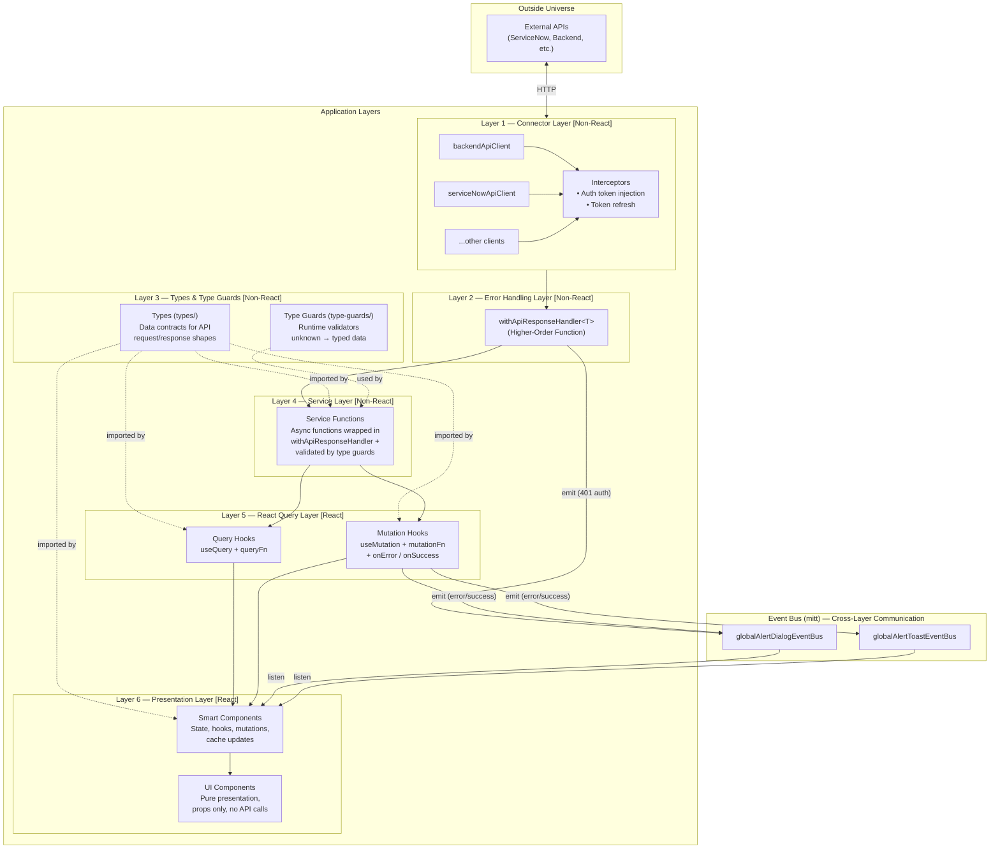
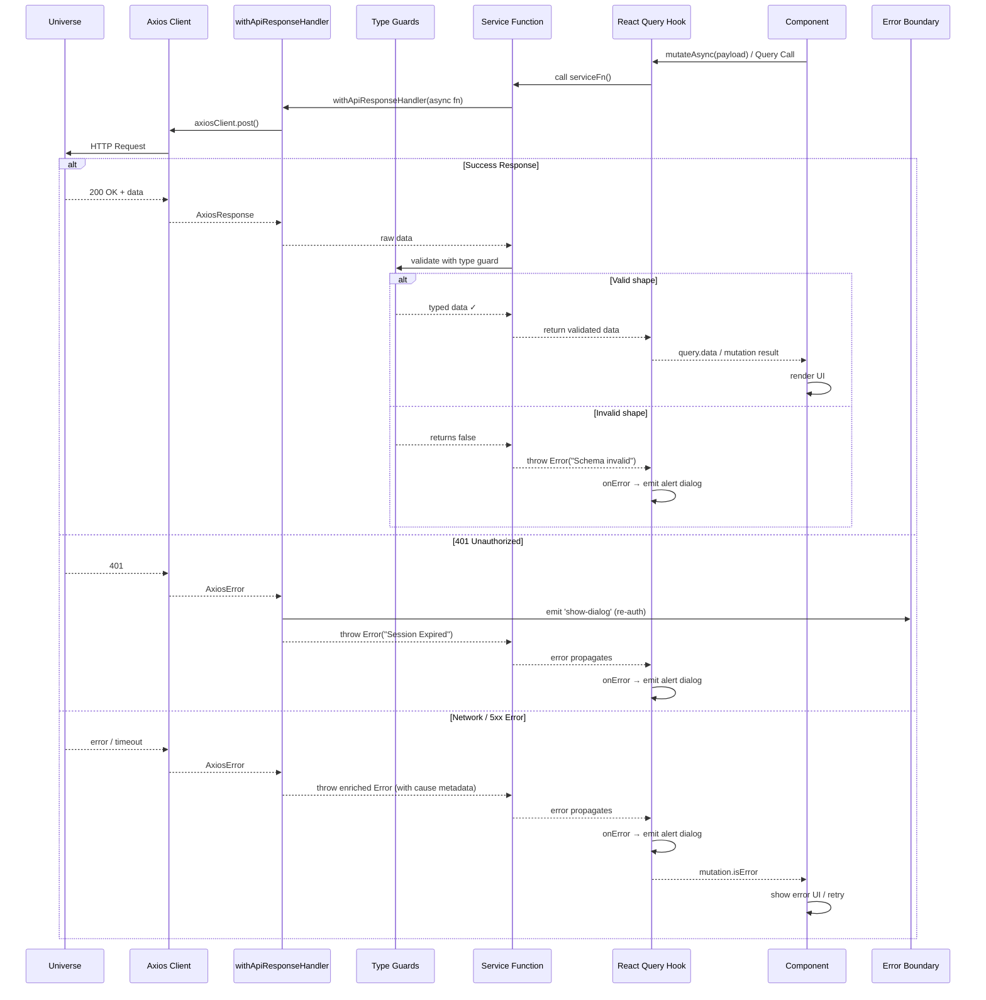
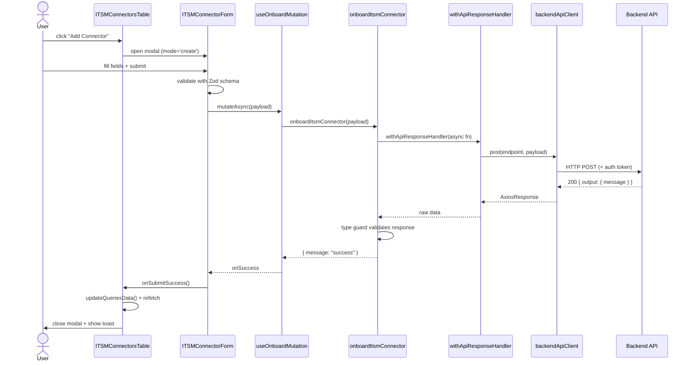
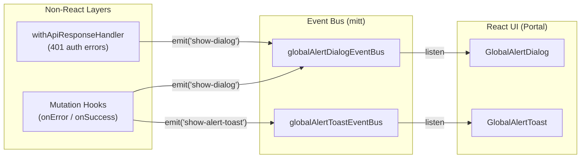

# React Application Coding Standards

Standards and conventions for the **itops-toolkit-frontend** codebase.

**Stack:** React 19 + TypeScript 5.9 + Vite + Tailwind CSS 4 + TanStack (Router, Query, Form, Table, Virtual) + Zod + Axios + MUI Material

---

## 1. Build Tooling -- Vite (Mandatory)

CRA is deprecated and must not be used. This project uses **Vite** with the TanStack Router plugin for automatic route generation.

| Rule                               | Details                                                           |
| ---------------------------------- | ----------------------------------------------------------------- |
| Use `import.meta.env` for env vars | Never `process.env`                                               |
| One Vite config per build target   | `vite.config.ts` (SPA) + `vite.config.itops-mfe.ts` (MFE library) |

**From** `src/config/app-env-config.ts`:

```ts
const raw = import.meta.env;
const validatedAppEnvConfig = envSchema.parse(raw);

export const appEnvConfig: AppEnvConfig = {
    isInDevelopmentMode: validatedAppEnvConfig.VITE_APP_PIPELINE_STAGE === 'development',
    applicationBasepath: validatedAppEnvConfig.VITE_APP_BASE_PATH,
};
```

---

## 2. Project Structure

```
src/
├── main.tsx                          # App bootstrap + global error handlers
├── App.tsx                           # Root component
├── AppRouter.tsx                     # TanStack Router instance
├── AppLayout.tsx                     # Shell layout
├── react-query-client.tsx            # QueryClient config
├── routeTree.gen.ts                  # Auto-generated route tree (do not edit)
│
├── routes/                           # File-based routing (TanStack Router)
│   ├── __root.tsx
│   ├── (app)/_app/
│   │   ├── (dev-space)/
│   │   │   └── admin.tsx
│   │   ├── (itops)/itops/
│   │   │   └── index.tsx
│   │   └── (transition-ai)/transition-ai/
│   │       ├── knowledge-ai.tsx
│   │       └── knowledge-browser.tsx
│   └── (auth)/_auth/
│       ├── login.tsx
│       └── logout.tsx
│
├── modules/                          # Business domain modules
│   ├── admin-portal/
│   ├── knowledge-ai/
│   ├── auth/
│   └── dev-temp-space/
│
├── shared/                           # Cross-cutting, domain-free code
│   ├── components/
│   │   ├── smart/                    # Logic-heavy (ChatBot, VirtualTable, RichTextEditor...)
│   │   └── ui/                       # Presentational (Modal, Placeholders, Skeletons...)
│   ├── context/                      # React Context (ViewModeContext)
│   ├── hooks/                        # Custom hooks (useClickOutside, useGetContextualResponseMutation...)
│   ├── services/                     # Shared API functions (post-chat-message, get-contextual-response...)
│   ├── type-guards/                  # Type predicate functions
│   ├── types/                        # Shared TypeScript types
│   └── utils/                        # Pure utilities (logger, deep-merge-object, query-data-updater...)
│
├── api/                              # HTTP layer
│   ├── axios-clients/
│   │   ├── backend-api/              # Axios instance + interceptors
│   │   └── service-now-api/          # Axios instance + interceptors
│   ├── types/
│   └── utils/                        # withApiResponseHandler, error message extraction
│
├── config/                           # App config (endpoints, auth, feature flags)
├── store/                            # Redux store (minimal, mainly for future use)
├── license/                          # License-gating utilities
├── providers/                        # Root-level React providers
└── itops-mfe/                        # Micro-frontend build exports
```

---

## 3. Module Architecture

A **module** represents a bounded business domain. Modules are self-contained mini-apps with their own pages, components, hooks, services, and types.

**Rules:**

- Modules own their business logic, data, and workflows
- Modules are isolated -- **never directly import from another module**
- Cross-module communication uses the **event bus** (see section 13)

### Actual sub-module structure: `modules/admin-portal/modules/llms/`

```
modules/admin-portal/modules/llms/
├── components/
│   └── smart/                        # Logic-heavy components
│       ├── LLMConfigurationsTable/
│       │   └── LLMConfigurationsTable.tsx
│       └── LLMForm/
│           └── LLMForm.tsx
├── hooks/
│   ├── useLLMsListWithConfigQuery.tsx
│   ├── useLLMTagOptionsQuery.tsx
│   ├── useOnboardLLMMutation.tsx
│   ├── useUpdateLLMMutation.tsx
│   └── useDeleteLLMMutation.tsx
├── services/
│   ├── fetch-llms-list-with-config.ts
│   ├── fetch-llms-list.ts
│   ├── onboard-llm.ts
│   └── delete-llm.ts
├── types/
│   └── llms.d.ts
├── type-guards/
│   └── llm-type-guards.ts
├── constants/
│   ├── llm-type-options.ts
│   └── llm-config-fields-by-type.ts
├── utils/
│   └── get-llm-config-fields-by-type.ts
└── mocks/
    └── get-mock-llms-list.ts
```

### Actual module structure: `modules/knowledge-ai/`

```
modules/knowledge-ai/
├── pages/
│   └── KnowledgeAIPage.tsx
├── components/
│   ├── smart/
│   │   ├── CreateKBArticleForm/
│   │   ├── CreateKBArticleModal/
│   │   ├── DuplicateArticles/
│   │   ├── IssuesWithoutKBArticleTable/
│   │   ├── KnowledgeBaseOverview/
│   │   ├── LowScoringArticles/
│   │   ├── MergeDuplicateKBArticlesModal/
│   │   ├── RecentKBArticlesList/
│   │   ├── RefineLowScoringArticleModal/
│   │   └── UpdateKBArticelForm/
│   └── ui/
│       ├── KBArticleCard/
│       ├── KBArticlesList/
│       ├── KBCategoryCountBadge/
│       ├── RecentKBArticleCard/
│       └── MergeArticleDetailsSection/
├── hooks/
├── services/
├── type-guards/
├── types/
├── mocks/
└── utils/
```

### Nested sub-modules: `modules/admin-portal/`

Large modules can contain nested sub-modules. Each sub-module follows the same structure.

```
modules/admin-portal/
├── pages/
├── components/
│   ├── smart/
│   └── ui/
│       └── TabButton/
└── modules/                          # Sub-modules
    ├── itsm-connectors/
    │   ├── components/smart/
    │   ├── hooks/
    │   ├── services/
    │   ├── type-guards/
    │   └── types/
    ├── lite-llm-proxy/
    │   ├── components/smart/
    │   ├── hooks/
    │   ├── services/
    │   ├── type-guards/
    │   ├── types/
    │   └── mocks/
    ├── llms/
    │   ├── components/smart/
    │   ├── constants/
    │   ├── hooks/
    │   ├── services/
    │   ├── type-guards/
    │   ├── types/
    │   └── utils/
    ├── prompt-library/
    │   ├── components/smart/
    │   ├── components/ui/
    │   ├── hooks/
    │   ├── services/
    │   ├── types/
    │   └── utils/
    └── vault/
        ├── components/smart/
        ├── components/ui/
        ├── constants/
        ├── hooks/
        ├── services/
        └── types/
```

---

## 4. Page Components (View Layer)

Pages orchestrate data fetching, wire events, and compose smart/UI components. They live in `modules/<name>/pages/`.

**From** `modules/admin-portal/pages/AdminPage.tsx`:

```tsx
const ITSMConnectorsTable = lazy(() => import('../modules/itsm-connectors/components/smart/ITSMConnectorsTable/ITSMConnectorsTable'));
const LLMConfigurationsTable = lazy(() => import('../modules/llms/components/smart/LLMConfigurationsTable/LLMConfigurationsTable'));
const VaultConfig = lazy(() => import('../modules/vault/components/ui/VaultConfig/VaultConfig'));

const AVAILABLE_TABS: AdminTab[] = [
    { key: 'prompt-library', displayName: 'Prompt Library' },
    { key: 'llm-models', displayName: 'LLM Models' },
    { key: 'itsm-connectors', displayName: 'ITSM Connectors' },
    { key: 'vault', displayName: 'Vault' },
];

const AdminPage: React.FC = () => {
    const [selectedTab, setSelectedTab] = useState<AdminTab>(AVAILABLE_TABS[0]);

    return (
        <ShellLayout>
            <ShellLayout.Header>
                {AVAILABLE_TABS.map((tab) => (
                    <TabButton key={tab.key} id={tab.key} displayName={tab.displayName} isSelected={selectedTab.key === tab.key} onSelect={handleOnTabSelected} />
                ))}
            </ShellLayout.Header>
            <ShellLayout.Body>
                <Suspense fallback={<ComponentLoadingIndicator />}>
                    {selectedTab.key === 'llm-models' ? <LLMConfigurationsTable /> : null}
                    {selectedTab.key === 'itsm-connectors' ? <ITSMConnectorsTable /> : null}
                    {/* ... other tabs */}
                </Suspense>
            </ShellLayout.Body>
        </ShellLayout>
    );
};

export default AdminPage;
```

**Pattern:** Pages use `useState` for tab selection, `lazy()` + `Suspense` for code-split sub-modules, and compose smart + UI components via `ShellLayout`.

---

## 5. Smart vs UI Components

### Smart Components (`components/smart/`)

Contain logic: state, hooks, mutations, event handling. May call APIs indirectly through hooks.

**From** `shared/components/smart/ChatBot/ChatBot.tsx`:

```tsx
interface ChatBotProps {
    systemMessage?: string;
    isLoading?: boolean;
    isError?: boolean;
    sendMessage: ({ conversation, userMessage }: {...}) => Promise<ChatMessageResponseData>;
    onResponse?: (data: ChatMessageResponseData) => void;
}

const ChatBot: React.FC<ChatBotProps> = ({ systemMessage, isLoading, ... }) => {
    const [conversation, setConversation] = useState<ConversationEntry[]>([]);
    const messageMutation = useMutation({...});

    const handleSendMessage = useCallback(async (message: string) => {
        await messageMutation.mutateAsync(...);
    }, []);

    return (/* JSX with logic */);
};
```

### UI Components (`components/ui/`)

Pure presentation. No API calls, no side effects. Receive data and callbacks through props.

**From** `shared/components/ui/Modal/Modal.tsx` -- uses the **compound component** pattern:

```tsx
interface ModalComposition {
    Header: FC<SlotProps>;
    Body: FC<SlotProps>;
    Footer: FC<SlotProps>;
    ActionButton: FC<{ children: ReactNode; onClick: () => void; variant?: ActionButtonVariant; ... }>;
}

const Header: FC<SlotProps> = ({ children, className }) =>
    <div className={twMerge('flex items-center gap-2.5 mb-2.5', className)}>{children}</div>;
Header.displayName = 'Modal.Header';

const Body: FC<SlotProps> = ({ children, className }) =>
    <div className={twMerge('mb-4 max-h-[60dvh] overflow-y-auto text-xs ...', className)}>{children}</div>;
Body.displayName = 'Modal.Body';

const Modal: FC<ModalProps> & ModalComposition = ({ open, size = 'md', onClose, ... }) => {
    return createPortal(/* overlay + dialog */, getPortalContainer());
};

Modal.Header = Header;
Modal.Body = Body;
Modal.Footer = Footer;
Modal.ActionButton = ActionButton;

export default Modal;
```

**Usage in** `LLMConfigurationsTable.tsx`:

```tsx
<Modal open={!!deleteLLM} onClose={() => setDeleteLLM(null)}>
    <Modal.Header>
        <Trash2 className="text-red-500" size={18} />
        <h2 className="text-sm font-semibold">Delete LLM</h2>
    </Modal.Header>
    <Modal.Body>
        <LLMForm mode="delete" initialValues={deleteLLM} onSubmitSuccess={handleDeleteSuccess} />
    </Modal.Body>
</Modal>
```

---

## 6. Routing (TanStack Router -- File-Based)

Routes are defined by file structure inside `src/routes/`. TanStack Router auto-generates `routeTree.gen.ts` -- never edit that file manually.

**From** `src/routes/(app)/_app/(dev-space)/admin.tsx`:

```tsx
import { appConfig } from '@/config/app-config';
import { getAuthProviderInstance } from '@/modules/auth/utils/get-auth-provider-instance';
import { ComponentLoadingIndicator } from '@/shared/components/ui/ComponentLoadingIndicator/ComponentLoadingIndicator';
import UnAuthorisedAccessError from '@/shared/utils/errors/UnAuthorisedAccessError';
import { createFileRoute, lazyRouteComponent } from '@tanstack/react-router';

export const Route = createFileRoute('/(app)/_app/(dev-space)/admin')({
    component: lazyRouteComponent(async () => import('@/modules/admin-portal/pages/AdminPage')),

    staticData: {
        crumb: { label: 'Admin' },
    },

    pendingMs: 1000,

    beforeLoad: async () => {
        const authUserMemberOfGroups = await getAuthProviderInstance().getUserMemberOfGroups();
        if (!authUserMemberOfGroups?.includes(appConfig.accessControl.pages.gbac.admin)) throw new UnAuthorisedAccessError('', '');
    },

    pendingComponent: ComponentLoadingIndicator,
});
```

**Route conventions:**

- `(app)` / `(auth)` -- pathless layout groups
- `_app` / `_auth` -- layout routes (render a layout wrapper, children render inside `<Outlet />`)
- `lazyRouteComponent` -- code-splits page chunks
- `beforeLoad` -- runs guards (license, auth) before rendering
- `pendingComponent` -- shows a loading indicator while the lazy chunk loads
- `staticData.crumb` -- provides breadcrumb labels

---

## 7. State Management

| Concern              | Tool                 | When to use                                            |
| -------------------- | -------------------- | ------------------------------------------------------ |
| Complex UI state     | `useReducer`         | Pages with interdependent filters, selections, dialogs |
| Simple UI state      | `useState`           | Toggle, input value, open/close                        |
| Server state         | TanStack React Query | All data from APIs                                     |
| Global settings      | React Context        | Theme, view mode, auth                                 |
| Cross-module signals | Event bus            | Module A triggers refresh in Module B                  |
| Redux                | Redux Toolkit        | Available but used minimally                           |

### useState -- from `modules/admin-portal/pages/AdminPage.tsx`

For simpler UI state like tab selection and modal toggles, `useState` is sufficient:

```ts
interface AdminTab {
    key: string;
    displayName: string;
}

const AVAILABLE_TABS: AdminTab[] = [
    { key: 'prompt-library', displayName: 'Prompt Library' },
    { key: 'llm-models', displayName: 'LLM Models' },
    { key: 'itsm-connectors', displayName: 'ITSM Connectors' },
    { key: 'vault', displayName: 'Vault' },
];

const AdminPage: React.FC = () => {
    const [selectedTab, setSelectedTab] = useState<AdminTab>(AVAILABLE_TABS[0]);

    const handleOnTabSelected = useCallback((selectedTabKey: string) => {
        const tab = AVAILABLE_TABS.find((t) => t.key === selectedTabKey);
        if (tab) setSelectedTab(tab);
    }, []);

    // ... renders tabs and lazy-loaded sub-module components
};
```

For pages with complex interdependent state (filters, selections, unsaved-changes guards), prefer `useReducer` with a discriminated union of actions and action creators.

### React Context -- from `shared/context/ViewModeContext.tsx`

```tsx
export type ViewMode = 'compact' | 'normal' | 'large';

const ViewModeContext = createContext<ViewModeContextValue | null>(null);

export const ViewModeProvider = ({ children }: { children: ReactNode }) => {
    const [viewMode, setViewModeState] = useState<ViewMode>(getStoredMode);

    const setViewMode = (mode: ViewMode) => {
        setViewModeState(mode);
        try {
            localStorage.setItem(STORAGE_KEY, mode);
        } catch {}
    };

    return <ViewModeContext.Provider value={{ viewMode, setViewMode, zoom: VIEW_MODE_ZOOM[viewMode] }}>{children}</ViewModeContext.Provider>;
};

export const useViewMode = (): ViewModeContextValue => {
    const ctx = useContext(ViewModeContext);
    if (!ctx) throw new Error('useViewMode must be used within ViewModeProvider');
    return ctx;
};
```

---

## 8. React Query (Server State)

All data fetching goes through TanStack React Query. Never store API data in Redux or useState.

### useQuery -- from `modules/admin-portal/modules/llms/hooks/useLLMsListWithConfigQuery.tsx`

```ts
export const useLLMsListWithConfigQuery = () => {
    const queryKey = ['llms-list-with-config'];
    const query = useQuery<Array<LLM>, Error>({
        queryKey: [...queryKey],
        queryFn: fetchLLMsListConfig,
        retry: false,
        staleTime: 5 * 60 * 1000,
    });

    return { queryKey, query };
};
```

### useMutation -- from `modules/admin-portal/modules/llms/hooks/useDeleteLLMMutation.tsx`

```ts
const useDeleteLLMMutation = () => {
    return useMutation({
        mutationFn: deleteLLM,
        onError: (error) => {
            logger.debug(error);
            globalAlertDialogEventBus.emit('show-dialog', {
                title: getErrorTitle(error),
                note: error?.message,
                priority: 'normal',
                severity: 'error',
                buttonText: 'Dismiss',
            });
        },
        onSuccess: (data) => {
            logger.debug(data);
        },
    });
};
```

**Conventions:**

- Query hooks live in `modules/<name>/hooks/use<Name>Query.ts`
- Mutation hooks live in `modules/<name>/hooks/use<Name>Mutation.ts`
- `onError` shows a global alert dialog; `onSuccess` shows a toast
- No Redux for API data

---

## 9. API Services

Service functions are **promise-based**, typed, and wrapped with `withApiResponseHandler` for centralized error handling.

### Axios Client -- from `api/axios-clients/backend-api/backend-api-client.ts`

```ts
import { appConfig } from '@/config/app-config';
import axios from 'axios';
import requestInterceptorInsertAuthToken from './apply-auth-token.interceptor';
import { refreshAuthTokenInterceptor } from './refresh-auth-token.interceptor';

const backendApiClient = axios.create({
    baseURL: appConfig.backend.api.baseUrl,
    withCredentials: false,
    timeout: 1000 * 60 * 2,
    timeoutErrorMessage: 'Request time out. Please try again later !',
});

backendApiClient.interceptors.request.use(requestInterceptorInsertAuthToken);
backendApiClient.interceptors.response.use(
    (response) => response,
    (error) => refreshAuthTokenInterceptor(error),
);

export default backendApiClient;
```

### Service Function -- from `modules/admin-portal/modules/llms/services/fetch-llms-list-with-config.ts`

```ts
import { withApiResponseHandler } from '@/api/utils/with-api-response-handler-hof';
import type { LLM } from '../types/llms';
import { appConfig } from '@/config/app-config';
import { isLLMArray } from '../type-guards/llm-type-guards';
import backendApiClient from '@/api/axios-clients/backend-api/backend-api-client';

const fetchLLMsListConfig = async () => {
    return withApiResponseHandler<Array<LLM>>(async () => {
        const response = await backendApiClient.get(appConfig.backend.api.listLLMsWithConfig);

        if (response?.data?.output?.data && isLLMArray(response?.data?.output?.data)) {
            return response.data.output.data;
        } else {
            throw new Error('Unable to fetch the LLMs with Config from API response, failed to validate response JSON Schema !', {
                cause: { reason: 'response?.data?.output?.data schema is invalid !' },
            });
        }
    });
};

export default fetchLLMsListConfig;
```

**Pattern:** Every service function wraps its Axios call in `withApiResponseHandler`, validates the response shape, and throws a descriptive error if the shape is unexpected.

---

## 10. Centralized API Error Handling (HOF)

**From** `api/utils/with-api-response-handler-hof.ts`:

```ts
export async function withApiResponseHandler<T>(apiCallFn: () => Promise<T>): Promise<T> {
    try {
        return await apiCallFn();
    } catch (error) {
        const mayBeAxiosError = (error as AxiosError) || undefined;

        if (mayBeAxiosError?.isAxiosError) {
            // No response -- network failure (offline, DNS, CORS)
            if (!mayBeAxiosError?.response) {
                throw new Error(refineNetworkErrorMessage(mayBeAxiosError), {
                    cause: { networkCode: mayBeAxiosError.code?.toUpperCase(), isNetworkError: true },
                });
            }

            const status = mayBeAxiosError.response.status;

            // 401 -- show re-authentication dialog
            if (status === 401) {
                globalAlertDialogEventBus.emit('show-dialog', {
                    title: 'Authentication Error !',
                    severity: 'error',
                    buttonText: 'Click here to Re-Authenticate !',
                    onButtonClick: () => getAuthProviderInstance().login(),
                });
                throw new Error('Session Expired, Interactive Login required !', { cause: { networkCode: status } });
            }

            // 502/503/504 -- gateway errors
            if (status === 502 || status === 503 || status === 504) {
                throw new Error(`Gateway error occurred (status ${status}). Please try again later.`, ...);
            }

            // ... structured API messages, generic server errors, 4xx fallback
        }

        // Navigator offline, AbortError, TypeError fallbacks
        // ...
    }
}
```

This is the single error policy for all API calls. Individual mutation hooks can add their own `onError` handlers on top of this for UI-level feedback.

---

## 11. Type Guards

Use type guard functions to validate unknown API responses at runtime.

**From** `modules/admin-portal/modules/llms/type-guards/llm-type-guards.ts`:

```ts
export const isLLM = (value: unknown): value is LLM => {
    if (typeof value !== 'object' || value === null) return false;

    const candidate = value as Record<string, unknown>;

    return (
        typeof candidate.llm_tag === 'string' &&
        typeof candidate.llm_type === 'string' &&
        typeof candidate.updated_by === 'string' &&
        typeof candidate.updated_at === 'string' &&
        typeof candidate.llm_config === 'object' &&
        candidate.llm_config !== null &&
        !Array.isArray(candidate.llm_config) &&
        Object.values(candidate.llm_config).every((val) => typeof val === 'string') &&
        (candidate.associated_agents_or_tools === null ||
            (Array.isArray(candidate.associated_agents_or_tools) && candidate.associated_agents_or_tools.every((item) => typeof item === 'string')))
    );
};

export const isLLMArray = (value: unknown): value is LLM[] => {
    return Array.isArray(value) && value.every(isLLM);
};
```

---

## 12. Environment & Config Validation (Zod)

All environment variables are validated at startup. If any required var is missing or invalid, the app fails fast.

**From** `env.schema.ts`:

```ts
import { z } from 'zod';

const envSchema = z.object({
    VITE_APP_PIPELINE_STAGE: z.enum(['development', 'test', 'uat', 'production'], {
        message: 'VITE_APP_PIPELINE_STAGE must be one of development, test, uat, production',
    }),
    VITE_APP_BASE_PATH: z
        .string()
        .trim()
        .min(1, 'VITE_APP_BASE_PATH is required')
        .refine((value) => value.startsWith('/'), { message: 'VITE_APP_BASE_PATH must start with /' })
        .refine((value) => value.endsWith('/'), { message: 'VITE_APP_BASE_PATH must end with /' }),
});

export default envSchema;
```

---

## 13. Event Bus (Cross-Module Communication)

Used for decoupled communication between modules. Modules never import from each other directly.

**Global alert dialog event bus** (used across the codebase):

```ts
// Emitting from a mutation hook
globalAlertDialogEventBus.emit('show-dialog', {
    title: 'Authentication Error !',
    note: authMessage,
    severity: 'error',
    buttonText: 'Click here to Re-Authenticate !',
    onButtonClick: () => getAuthProviderInstance().login(),
});

// Emitting from a mutation success
globalAlertToastEventBus.emit('show-alert-toast', {
    title: `${data?.number?.display_value} updated successfully !`,
    severity: 'success',
    position: 'top-center',
    autoCloseDuration: 5000,
});
```

The `GlobalAlertDialog` and `GlobalAlertToast` smart components listen on these buses and render accordingly, inside the portal containment system.

---

## 14. Forms (TanStack Form + Zod)

Use TanStack Form for all form handling. Integrate with Zod for schema-based validation.

**From** `modules/admin-portal/modules/llms/components/smart/LLMForm/LLMForm.tsx`:

```ts
const awsNovaConfigSchema = z.object({
    AWS_ACCESS_KEY_ID: requiredString512Chars('AWS access key is required'),
    AWS_SECRET_ACCESS_KEY: requiredString512Chars('AWS secret access key is required'),
    AWS_REGION_NAME: requiredString512Chars('AWS region is required').regex(/^([a-z]{2}-(?:gov-|iso-|isob-|)[a-z]+-\d+)$/, 'AWS region must be valid, e.g. us-east-1'),
});

const azureOpenAIConfigSchema = z.object({
    AZURE_API_KEY: requiredString512Chars('Azure API key is required'),
    AZURE_API_BASE: httpsUrlSchema('Azure API base URL is required', 'Azure API base must be a valid URL'),
    AZURE_API_VERSION: requiredString512Chars('Azure API version is required'),
});

const llmTagSchema = z
    .string()
    .trim()
    .min(1, 'LLM tag is required')
    .max(15, 'LLM tag length must be less than 15 chars!')
    .regex(/^[a-z0-9_-]+$/, 'Only lowercase letters, numbers, underscore (_) and hyphen (-) are allowed');

export const onboardLLMRequestSchema = baseSchema.superRefine((val, ctx) => {
    if (val.llm_type === 'AWS Nova') {
        const result = awsNovaConfigSchema.safeParse(val.llm_config);
        if (!result.success) {
            result.error.issues.forEach((issue) => ctx.addIssue({ path: ['llm_config', ...issue.path], message: issue.message, code: z.ZodIssueCode.custom }));
        }
    }
    // ... similar for Azure OpenAI, Google Gemini
});
```

Form instances use TanStack Form with mode-based submit config:

```ts
const formInstance = useForm({
    defaultValues: { llm_tag: '', llm_type: '', llm_config: {} },
    validators: {
        onSubmit: ['create', 'update'].includes(mode) ? onboardLLMRequestSchema : undefined,
    },
    onSubmit: async ({ value: payload }) => {
        if (mode === 'delete') await deleteMutation.mutateAsync({ llm_tag: payload.llm_tag });
        if (mode === 'create') await onboardMutation.mutateAsync({ payload });
        await onSubmitSuccess?.({ formDataWhileSubmitting: { ... }, message: response?.message ?? '' });
        formInstance.reset();
    },
});
```

---

## 15. Custom Hooks

### Query Hook Pattern

**From** `modules/admin-portal/modules/llms/hooks/useLLMsListWithConfigQuery.tsx`:

```ts
export const useLLMsListWithConfigQuery = () => {
    const queryKey = ['llms-list-with-config'];
    const query = useQuery<Array<LLM>, Error>({
        queryKey: [...queryKey],
        queryFn: fetchLLMsListConfig,
        retry: false,
        staleTime: 5 * 60 * 1000,
    });

    return { queryKey, query };
};
```

### Shadow DOM-safe Hook Pattern

**From** `shared/hooks/useClickOutside.ts`:

```ts
/**
 * Uses `composedPath()` instead of `e.target` / `.contains()` so it works
 * correctly inside Shadow DOM.
 */
export function useClickOutside(refs: RefObject<Element | null> | RefObject<Element | null>[], onClickOutside: () => void, enabled = true): void {
    useEffect(() => {
        if (!enabled) return;
        const refArray = Array.isArray(refs) ? refs : [refs];

        const handler = (e: MouseEvent) => {
            const path = e.composedPath();
            const isInside = refArray.some((ref) => ref.current && path.includes(ref.current));
            if (!isInside) onClickOutside();
        };

        document.addEventListener('mousedown', handler);
        return () => document.removeEventListener('mousedown', handler);
    }, [refs, onClickOutside, enabled]);
}
```

---

## 16. Utilities

### Logger -- from `shared/utils/logger.ts`

Use `logger` instead of `console.*`. ESLint enforces `no-console`.

```ts
const LogLevel = { ERROR: 0, WARN: 1, INFO: 2, DEBUG: 3 } as const;

class Logger {
    private currentLevel: LogLevel;

    error(...args: Array<unknown>) {
        if (this.currentLevel >= LogLevel.ERROR) console.error(this.formatPrefix('ERROR'), ...args);
    }
    debug(...args: Array<unknown>) {
        if (this.currentLevel >= LogLevel.DEBUG) console.debug(this.formatPrefix('DEBUG'), ...args);
    }
    group(label: string, callback: () => void) {
        /* ... */
    }
    table(data: unknown) {
        /* ... */
    }
}

const logger = new Logger(appEnvConfig.isInDevelopmentMode ? LogLevel.DEBUG : LogLevel.WARN);
export default logger;
```

### Generic Utilities -- from `shared/utils/`

**`deep-merge-object.ts`** -- type-safe deep merge with `DeepPartial<T>`:

```ts
type DeepPartial<T> = { [K in keyof T]?: T[K] extends object ? DeepPartial<T[K]> : T[K] };

function deepMerge<T extends object>(target: T, source: DeepPartial<T>): T {
    const result = { ...target };
    for (const key in source) {
        // ... handles arrays, nested objects, and primitives
    }
    return result;
}
```

**`query-data-updater.ts`** -- batch-update multiple React Query caches:

```ts
export const updateQueriesData = <T>(
    queryClient: QueryClient,
    {
        queryKeyFilter,
        updater,
    }: {
        queryKeyFilter: (queryKey: readonly unknown[]) => boolean;
        updater: (prev: T | undefined) => T | undefined;
    },
): void => {
    queryClient.setQueriesData<T>({ predicate: (query) => queryKeyFilter(query.queryKey) }, updater);
};
```

---

## 17. TypeScript Types

**From** `modules/admin-portal/modules/llms/types/llms.d.ts`:

```ts
export interface LLM {
    llm_tag: string;
    llm_type: string;
    llm_config: Record<string, string>;
    updated_by: string;
    updated_at: string;
    associated_agents_or_tools: Array<string> | null;
}

export interface OnboardLLMRequest {
    llm_tag: string;
    llm_type: string;
    llm_config: Record<string, string>;
}

export type OnboardLLMResponse = { message: string };

export interface DeleteLLMRequest {
    llm_tag: string;
}
export type DeleteLLMResponse = { message: string };
```

**Conventions:**

- Use `type` for data shapes and unions
- Use `interface` for component props and contracts
- Use union types instead of enums: `'create' | 'update' | 'delete' | 'view'` not `enum FormMode { ... }`
- Module types live in `modules/<name>/types/`
- Shared types live in `shared/types/`

---

## 18. Barrel Exports

Use `index.ts` barrel files for component groups to simplify imports.

**From** `shared/components/ui/Placeholders/index.ts`:

```ts
export { default as LoadingPlaceholder } from './LoadingPlaceholder';
export { default as ErrorPlaceholder } from './ErrorPlaceholder';
export { default as EmptyPlaceholder } from './EmptyPlaceholder';
```

**Usage:**

```ts
import { ErrorPlaceholder, EmptyPlaceholder } from '@/shared/components/ui/Placeholders';
```

---

## 19. Error Handling

### Global Error Boundary -- from `main.tsx`

```tsx
window.addEventListener('unhandledrejection', (event) => {
    errorLoggingService.report('unhandledrejection', event.reason);
});

window.addEventListener('error', (event) => {
    errorLoggingService.report('global', event.error ?? event.message);
});

const root = ReactDOM.createRoot(rootElement, {
    onCaughtError: errorLoggingService.onCaughtError,
    onUncaughtError: errorLoggingService.onUncaughtError,
    onRecoverableError: errorLoggingService.onRecoverableError,
});

root.render(
    <StrictMode>
        <ErrorBoundary
            fallbackRender={({ error, resetErrorBoundary }) => (
                <ErrorBoundaryFallback error={error as Error} reset={resetErrorBoundary} title="Something went wrong" description={JSON.stringify(error)} />
            )}
        >
            <App />
        </ErrorBoundary>
    </StrictMode>,
);
```

**Error handling layers:**

1. **Global** -- `window.addEventListener('error' | 'unhandledrejection')` + `react-error-boundary` in `main.tsx`
2. **API** -- `withApiResponseHandler` HOF catches all Axios errors, network errors, auth expiry
3. **Route** -- TanStack Router `defaultErrorComponent` per route
4. **Component** -- `react-error-boundary` wrapping individual component trees

---

## 20. Naming Conventions

| What                  | Convention                                | Example from codebase                                    |
| --------------------- | ----------------------------------------- | -------------------------------------------------------- |
| Component files       | PascalCase `.tsx`                         | `LLMConfigurationsTable.tsx`, `Modal.tsx`, `ChatBot.tsx` |
| Component directories | PascalCase (matches component)            | `LLMConfigurationsTable/`, `LLMForm/`                    |
| Hook files            | camelCase, `use` prefix                   | `useLLMsListWithConfigQuery.tsx`, `useClickOutside.ts`   |
| Service files         | kebab-case                                | `fetch-llms-list-with-config.ts`, `delete-llm.ts`        |
| Utility files         | kebab-case                                | `deep-merge-object.ts`, `query-data-updater.ts`          |
| Constant files        | kebab-case                                | `llm-type-options.ts`, `llm-config-fields-by-type.ts`    |
| Type files            | kebab-case or `index.d.ts`                | `llms.d.ts` in types directory                           |
| CSS Modules           | PascalCase `.module.scss`                 | `KBArticleCard.module.scss`                              |
| Interceptors          | kebab-case with `.interceptor.ts`         | `apply-auth-token.interceptor.ts`                        |
| Test files            | Match source + `.test.ts` in `__tests__/` | `__tests__/with-api-response-handler-hof.test.ts`        |
| Variables / functions | camelCase                                 | `selectedTab`, `fetchLLMsListConfig`                     |
| Types / interfaces    | PascalCase                                | `LLM`, `OnboardLLMRequest`, `ChatBotProps`               |
| Action types          | SCREAMING_SNAKE_CASE                      | `'SET_SEARCH_VALUE'`, `'SELECT_ITEM'`                    |
| Custom hooks          | `use` prefix, camelCase                   | `useViewMode`, `useDeleteLLMMutation`                    |

---

## 21. Import Conventions

Use the `@/` path alias for all cross-module imports. Use relative paths only within a component's own directory.

**From** `tsconfig.json`:

```json
{
    "compilerOptions": {
        "baseUrl": ".",
        "paths": { "@/*": ["./src/*"] }
    }
}
```

**Correct:**

```ts
// Cross-module (use alias)
import Modal from '@/shared/components/ui/Modal/Modal';
import { appConfig } from '@/config/app-config';
import logger from '@/shared/utils/logger';
import { updateQueriesData } from '@/shared/utils/query-data-updater';

// Within same module (relative is fine)
import type { LLM } from '../types/llms';
import { isLLMArray } from '../type-guards/llm-type-guards';
```

---

## 22. Styling

| Method                       | When                                       | Example                                        |
| ---------------------------- | ------------------------------------------ | ---------------------------------------------- |
| Tailwind CSS 4               | Default for all styling                    | `className="flex items-center gap-2.5 mb-2.5"` |
| `twMerge`                    | Merging Tailwind classes with overrides    | `twMerge('text-xs text-gray-500', className)`  |
| CSS Modules (`.module.scss`) | Scoped styles that Tailwind can't express  | `KBArticleCard.module.scss`                    |
| MUI Material                 | Complex UI widgets (Tooltip, Autocomplete) | `<Tooltip>`, `<Select>`                        |

**From** `shared/components/ui/Modal/Modal.tsx`:

```tsx
const Header: FC<SlotProps> = ({ children, className }) => <div className={twMerge('flex items-center gap-2.5 mb-2.5', className)}>{children}</div>;
```

---

## 23. ESLint (Mandatory)

**From** `eslint.config.js`:

```js
export default [
    ...tseslint.configs.recommended,
    {
        ignores: ['dist/**', 'build/**', 'node_modules/**', '*.config.js', '*.test.{js,ts,tsx}'],
        rules: {
            '@typescript-eslint/no-unused-vars': ['error', { argsIgnorePattern: '^_', varsIgnorePattern: '^_', ignoreRestSiblings: true }],
            '@typescript-eslint/no-explicit-any': 'error',
            '@typescript-eslint/consistent-type-imports': 'error',
            'no-console': 'error',
        },
    },
];
```

**Key enforced rules:**

- `no-console` -- use `logger` instead
- `no-explicit-any` -- use `unknown` and validate with type guards
- `consistent-type-imports` -- use `import type { ... }` for type-only imports
- Unused vars prefixed with `_` are allowed

---

## 24. Prettier (Mandatory)

**From** `prettier.config.js`:

```js
const config = {
    printWidth: 180,
    tabWidth: 4,
    singleQuote: true,
    trailingComma: 'all',
    bracketSpacing: true,
    arrowParens: 'always',
    semi: true,
    proseWrap: 'always',
    bracketSameLine: false,
};
```

---

## 25. Husky (Mandatory)

Pre-commit hooks enforce quality before code enters the repository:

```bash
npm run test && npm run prettier:check && npm run lint:check
```

If checks fail, the commit is aborted. Set `HUSKY=0` in CI to skip hooks (see deployment guide).

---

## 26. Testing

| Framework                | Purpose                           |
| ------------------------ | --------------------------------- |
| Vitest                   | Test runner + assertion library   |
| `@testing-library/react` | Component rendering + DOM queries |

**Test file location:** `__tests__/` directory adjacent to the source file.

```
src/api/utils/
├── with-api-response-handler-hof.ts
└── __tests__/
    └── with-api-response-handler-hof.test.ts

src/shared/components/ui/ErrorCauseRenderer/
├── ErrorCauseRenderer.tsx
└── __tests__/
    └── ErrorCauseRenderer.test.tsx
```

**Scripts:**

```bash
npm run test              # vitest run (single pass)
npm run test:watch        # vitest (watch mode)
npm run test:coverage     # vitest run --coverage
```

---

## 27. Performance

| Technique        | How it's used                                                      |
| ---------------- | ------------------------------------------------------------------ |
| Code splitting   | `lazyRouteComponent` in route definitions                          |
| Memoization      | `memo()` on smart components like `LLMConfigurationsTable`         |
| Virtualization   | `@tanstack/react-virtual` via shared `VirtualTable` component      |
| Query caching    | TanStack Query manages stale time, background refresh              |
| Manual chunks    | Vite config splits vendor bundles (react, router, mui, auth, etc.) |
| CSS minification | Lightning CSS in production                                        |

---

## 28. Security Rules

- No secrets or client secrets in frontend code
- Env vars only for non-sensitive config (`VITE_APP_PIPELINE_STAGE`, `VITE_APP_BASE_PATH`)
- Auth tokens managed by interceptors, never logged
- `no-console` ESLint rule prevents accidental token logging
- All auth flows use OAuth / Keycloak SSO / Entra ID

---

## 29. Non-Negotiable Rules

- CRA is not allowed -- Vite only
- UI components (`components/ui/`) never call APIs
- Modules do not import from other modules
- Shared layer contains no business logic
- ESLint + Prettier enforced on commit via Husky
- `no-console` -- use `logger` utility
- `no-explicit-any` -- use `unknown` + type guards
- `consistent-type-imports` -- use `import type { ... }`
- All API calls wrapped in `withApiResponseHandler`
- All env vars validated with Zod at startup

---

## 30. Layered Architecture

The application follows a strict layered architecture. Each layer has a single responsibility. Errors can be handled, propagated, or silenced at any layer.

### Architecture Overview (Component Diagram)



### Error Propagation (Sequence Diagram)

Errors flow upward through the layers. Each layer can **handle**, **enrich + propagate**, or **silence** an error.



### Data Flow Example — ITSM Connectors (Sequence Diagram)



### Event Bus — Cross-Layer Communication (Component Diagram)

Non-React layers (1–4) use **mitt** event emitters to communicate with React layers (5–6).


